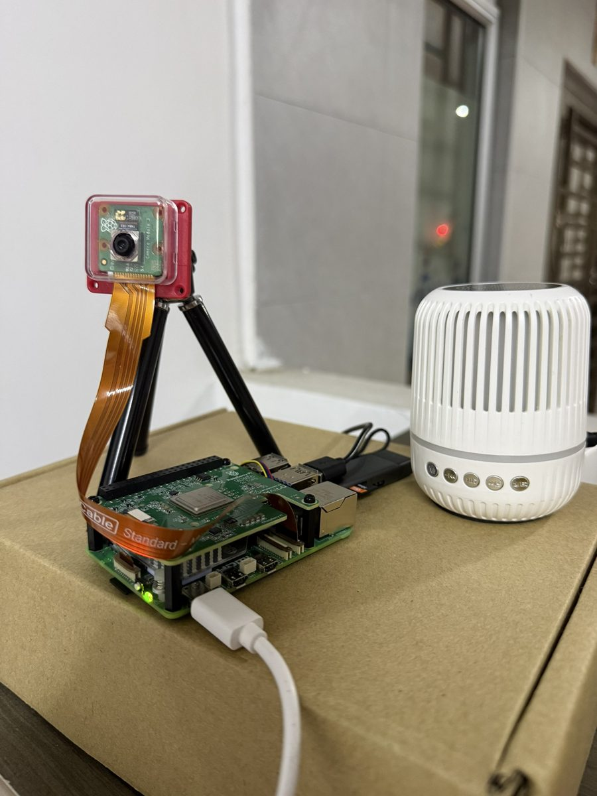
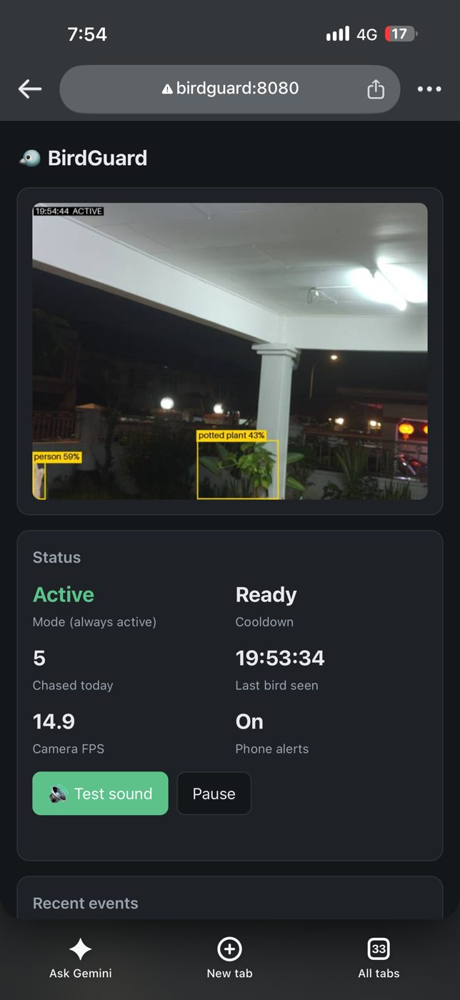
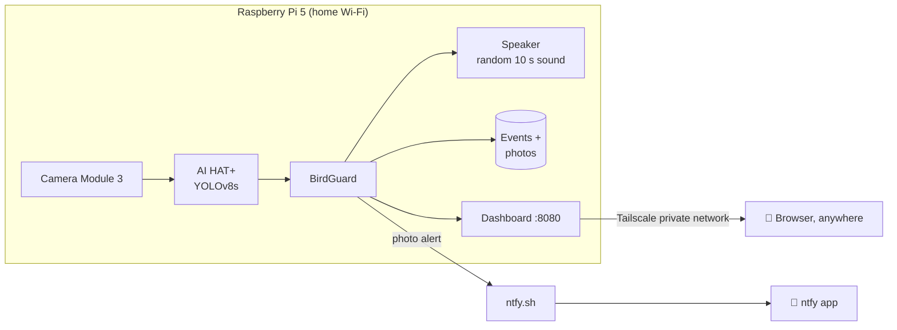
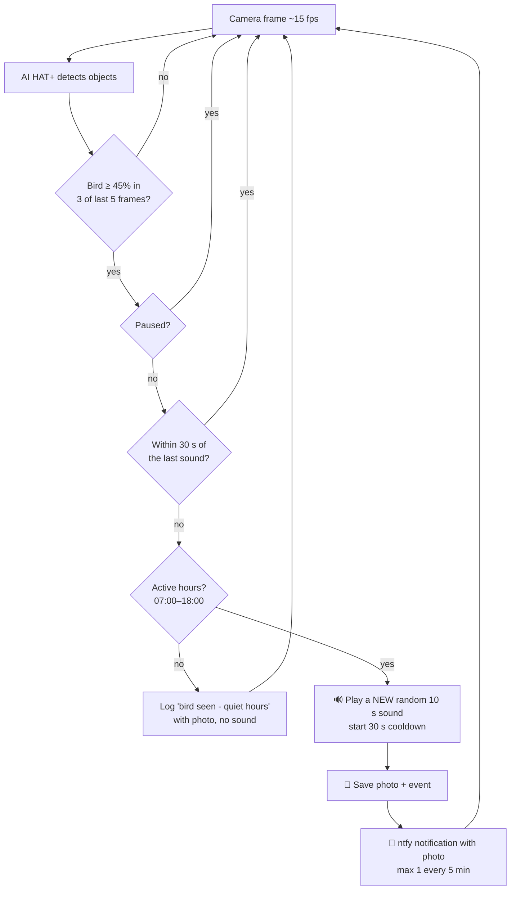

# 🐦 BirdGuard

**An AI bird deterrent built on a Raspberry Pi 5.** A camera watches the area,
the AI HAT+ recognises birds in real time, and a speaker plays a random
scary sound to chase them away. You can check it from anywhere on your phone
and get a push notification with a photo every time it acts.

<table>
<tr>
<td width="55%"></td>
<td width="45%"></td>
</tr>
<tr>
<td align="center"><sub>The device: Pi 5 + AI HAT+, Camera Module 3 and a Bluetooth speaker</sub></td>
<td align="center"><sub>The dashboard, opened on a phone over 4G</sub></td>
</tr>
</table>

---

## Contents

1. [Requirements](#1-requirements)
2. [Hardware](#2-hardware)
3. [Software](#3-software)
4. [How it works](#4-how-it-works)
5. [Setup guide](#5-setup-guide)
6. [Using BirdGuard](#6-using-birdguard)
7. [Testing](#7-testing)
8. [Settings](#8-settings)
9. [Troubleshooting](#9-troubleshooting)
10. [Adding accessories](#10-adding-accessories)
11. [For developers](#11-for-developers)

More guides: [Hardware & mounting](docs/HARDWARE.md) · [Bluetooth speaker](docs/BLUETOOTH.md) · [Testing](docs/TESTING.md)

---

## 1. Requirements

What BirdGuard was built to do, and how each requirement is met:

| # | Requirement | How it's done | Setting |
|---|---|---|---|
| R1 | Detect birds with the camera | A YOLOv8s model runs on the AI HAT+ (Hailo-8, 26 TOPS) at about 15 frames per second and recognises the COCO class "bird" | `detector` |
| R2 | Avoid false alarms | A bird must be seen in **3 of the last 5 frames** with at least **45%** confidence | `trigger.confirm_frames`, `detector.score_threshold` |
| R3 | Play a **random** sound so birds don't get used to it | Each trigger builds a **new** clip from 8 sound types (raptor screech, owl, crow, distress chirps, siren, noise bursts, bangs, beeps) plus any `.wav` files you add. Pitch, speed and volume are randomised, and the same type never plays twice in a row. | `deterrents.sound` |
| R4 | The sound lasts **10 seconds** | Every clip is exactly 10 s | `deterrents.sound.duration_seconds` |
| R5 | **At most one sound every 30 seconds** | The 30 s cooldown starts when a sound **starts**, so sounds can never overlap | `trigger.cooldown_seconds` |
| R6 | Quiet hours | Sounds play only from **07:00 to 18:00**. Outside those hours birds are logged but no sound plays. This can be switched off. | `schedule` |
| R7 | Monitor from anywhere | Web dashboard: live view, status, event history with photos, Test sound and Pause buttons. Reached securely from outside the home through **Tailscale**. | `web` |
| R8 | Know when it acts | A **push notification with the photo** through **ntfy** (at most 1 every 5 minutes) | `notify.ntfy` |
| R9 | Easy to install and keep running | One installer, **starts automatically at power-on**, restarts itself after any error, retries if the camera or AI HAT isn't ready | `install.sh` |
| R10 | Room for more accessories later (lights, sprinkler, …) | Add-on "deterrents" system. A GPIO relay output is already included. | `deterrents.*` |

## 2. Hardware

| Part | Purpose | Notes |
|---|---|---|
| **Raspberry Pi 5** (16GB used; 4GB+ is fine) | The computer | |
| **Raspberry Pi AI HAT+** (Hailo-8, 26 TOPS) | Runs the bird detection | Connects through the flat PCIe ribbon |
| **Raspberry Pi Camera Module 3** + **Pi 5 camera cable** | Watches the area | Pi 5 cable: narrow end at the Pi, wide end at the camera |
| **Raspberry Pi Active Cooler** | Keeps the Pi cool under AI load | Required |
| **Raspberry Pi 27W USB-C power supply** | Power | Phone chargers are often too weak |
| **microSD card**, 32–64GB, good brand | Operating system | We used the official Raspberry Pi 64GB card |
| **Speaker**: Bluetooth or USB audio | Plays the sounds | Our test used a cheap Bluetooth speaker. The Pi 5 has **no headphone jack**. See [speaker notes](docs/HARDWARE.md#the-speaker). |
| microSD card reader | Write the card from a computer | ⚠️ A cheap reader caused failed writes during our setup. Use a good one. |
| Optional: mini tripod / camera mount, case | Positioning | Keep the cooler's fan unobstructed |

Assembly (power **unplugged**): Active Cooler → camera cable into **CAM/DISP 0** →
AI HAT+ on the GPIO pins with the PCIe ribbon connected → speaker.
Full steps and mounting tips are in **[docs/HARDWARE.md](docs/HARDWARE.md)**.

## 3. Software

| Component | Role |
|---|---|
| **Raspberry Pi OS (64-bit)** with desktop | Operating system. The desktop lets you pair Bluetooth and configure things remotely. |
| **HailoRT + `hailo-all`** (with **DKMS**) | AI HAT driver and runtime. DKMS rebuilds the driver automatically after kernel updates. |
| **Picamera2 / libcamera** | Camera capture |
| **YOLOv8s** (`yolov8s_h8.hef`) | Object detection model, installed with `hailo-all` |
| **BirdGuard** (this repo, Python) | Detection logic, random sounds, dashboard, alerts |
| **Flask** | Serves the web dashboard on port 8080 |
| **PipeWire** (desktop) / **ALSA + bluez-alsa** (Lite) | Sound output, USB or Bluetooth |
| **systemd** | Starts BirdGuard at boot and restarts it if it stops |
| **Tailscale** (free) | Private, encrypted access from anywhere without opening router ports |
| **ntfy** (free) | Push notifications with photos to your phone |
| **Raspberry Pi Connect** (free, optional) | Remote desktop and terminal in a web browser |



## 4. How it works

Each camera frame goes through these checks:



**Example timeline:** a pigeon lands at 10:00:00. BirdGuard confirms it within a fraction of a second
and plays, say, *crow + siren + bangs* for 10 s. If the pigeon is still there at
10:00:30, it plays a **different** mix, for example *raptor + noise + owl*. Each time you can
see the event and its photo on the dashboard, and your phone gets an alert.

## 5. Setup guide

About 1–2 hours the first time. You only need a computer (Mac or PC) on the
same Wi-Fi. **No screen, keyboard or mouse is needed for the Pi.**

### 5.1 Try it on your computer first (optional, 5 minutes)

Run BirdGuard with a fake camera to see how it behaves. On a Mac, use Terminal:

```bash
git clone https://github.com/ianyian/myResp-bird.git && cd myResp-bird
python3 -m venv .venv && source .venv/bin/activate
pip install -r requirements-dev.txt
python -m birdguard run --simulate --ignore-schedule
```

Open <http://localhost:8080> and press **🐦 Simulate bird**. To hear the sounds:
`python -m birdguard sound-test --count 3`.

### 5.2 Write the SD card

1. Install **Raspberry Pi Imager** from <https://www.raspberrypi.com/software/>.
2. Choose **Device:** Raspberry Pi 5, **OS:** **Raspberry Pi OS (64-bit)**, **Storage:** your card.
3. In the customisation steps, set:
   - **Hostname:** `birdguard`
   - **User:** a username and password. Write them down. In this guide the user is `admin`; use yours.
   - **Wi-Fi:** your home network name, password and country
   - **Localisation:** your **time zone** (quiet hours use the Pi's clock)
   - **Remote access:** ✅ **Enable SSH** (password authentication)
   - **Raspberry Pi Connect:** ✅ on (optional; gives remote desktop in a browser)
4. Write, and wait for **"Write successful"**.

> **"Verifying write failed"?** That's almost always the card reader. Use a different reader
> or USB port (erase first in Disk Utility: *MS-DOS (FAT)*, *Master Boot Record*).

### 5.3 First boot and connecting

1. Push the card **fully** into the Pi's slot underneath. Only a few mm should stick out.
2. Plug in the power and **wait 3–5 minutes**.
3. From your computer:

```bash
ssh admin@birdguard.local
```

4. Update the system once. This takes 15–30 minutes, so keep the window open:

```bash
sudo apt update && sudo apt full-upgrade -y && sudo reboot
```

### 5.4 Remote desktop (optional)

Go to <https://connect.raspberrypi.com>, sign in, open **birdguard** and choose **Screen sharing**.
If the device isn't listed, run `rpi-connect on` and then `rpi-connect signin` on the Pi.

### 5.5 Install BirdGuard

Tip: run long steps inside `tmux` (`sudo apt install -y tmux`, then `tmux new -s setup`). If
your connection drops, reconnect and resume with `tmux attach -t setup`.

```bash
sudo apt install -y git
```

```bash
git clone https://github.com/ianyian/myResp-bird.git ~/myresp-bird
```

```bash
cd ~/myresp-bird && ./install.sh
```

The installer sets up the AI HAT software (with DKMS), the camera and sound
packages, and the auto-start service. If it asks you to, run `sudo reboot`. Then check everything:

```bash
cd ~/myresp-bird && python3 -m birdguard check
```

You want `[OK ]` for **speaker, AI model, camera, AI HAT**. Open
**http://birdguard.local:8080** (or `http://<Pi IP>:8080`; find the IP with `hostname -I`).

### 5.6 Speaker

- **Bluetooth:** on the remote desktop, click the **Bluetooth icon → Add Device** and pair the speaker.
  Then **right-click the volume icon** and select the speaker as the output. Details are in [docs/BLUETOOTH.md](docs/BLUETOOTH.md).
- **USB:** plug it in and select it in the volume icon.

Then press **Test sound** on the dashboard. You should hear 10 s of sound.

### 5.7 Access from anywhere (Tailscale)

1. Create a free account at <https://tailscale.com>.
2. On the Pi, run `curl -fsSL https://tailscale.com/install.sh | sh`, then `sudo tailscale up`. Open the link it prints and approve the device.
3. On your phone, install the **Tailscale** app, log in with the same account and switch it **on**.
4. Open **http://birdguard:8080** from anywhere. If the name doesn't work, use `http://<tailscale ip>:8080` (find the IP with `tailscale ip -4`).

Only devices on **your** Tailscale account can reach the Pi. Nothing is exposed to the internet.

### 5.8 Phone notifications (ntfy)

1. Make a secret topic name on the Pi: `echo birdguard-$(openssl rand -hex 5)`
2. Install the **ntfy** app on your phone and **subscribe** to that topic.
3. On the Pi, run `nano ~/myresp-bird/config.local.yaml` and set:

```yaml
notify:
  ntfy:
    enabled: true
    topic: birdguard-xxxxxxxxxx
```

4. Send a test alert with `python3 -m birdguard check`, then apply with `sudo systemctl restart birdguard`.

## 6. Using BirdGuard

**Dashboard** (`http://birdguard:8080`):
- **Live view**: red boxes are birds BirdGuard reacts to; yellow boxes are other objects or weaker detections.
- **Mode**: *Active*, *Quiet hours* or *Paused*. **Cooldown**: seconds until the next sound is allowed.
- **Chased today**, **Last bird seen**, **Camera FPS**, **Phone alerts**.
- **Test sound** plays a sound now (it also follows the cooldown). **Pause / Resume** stops sounds without stopping the camera.
- **Recent events**: tap a photo to see it full size.

**Phone apps:** Tailscale (remote access), ntfy (alerts), and optionally Termius (SSH terminal on iPhone).
Raspberry Pi Connect also gives a terminal in the browser.

**Everyday commands** (on the Pi):

| What | Command |
|---|---|
| Connect | `ssh admin@birdguard.local` (home) or `ssh admin@birdguard` (via Tailscale) |
| Is it running? | `systemctl status birdguard --no-pager` |
| Live log (Ctrl+C to exit) | `journalctl -u birdguard -f` |
| Restart (after changing settings) | `sudo systemctl restart birdguard` |
| Health check | `cd ~/myresp-bird && python3 -m birdguard check` |
| Update to the latest code | `cd ~/myresp-bird && git pull && sudo systemctl restart birdguard` |
| Edit your settings | `nano ~/myresp-bird/config.local.yaml` |
| Shut down before unplugging | `sudo shutdown now` (wait until the green light stops) |

BirdGuard **starts automatically** about 1–2 minutes after power-on.

## 7. Testing

- **Printable test birds:** [docs/test-birds/birdguard-test-birds.pdf](docs/test-birds/birdguard-test-birds.pdf) has 7 real bird photos, each checked with YOLOv8s before printing. Hold a page 0.5–1.5 m from the camera. A bird video on a phone works too.
- **Testing in the evening:** quiet hours block sounds after 18:00. Run `sudo systemctl stop birdguard`, then `python3 -m birdguard run --ignore-schedule` (Ctrl+C to stop), then `sudo systemctl start birdguard`.
- **Automated tests:** `python -m pytest` (32 tests: cooldown, quiet hours, sounds, dashboard, …).

Full test plan: **[docs/TESTING.md](docs/TESTING.md)**.

## 8. Settings

Defaults are in `config.yaml`. Put **your** changes in `config.local.yaml`; git ignores
that file, so updates never overwrite it. Restart after editing.

| Setting | Default | Meaning |
|---|---|---|
| `schedule.enabled` / `start` / `end` | `true`, `"07:00"`, `"18:00"` | Quiet hours. Set `enabled: false` to allow sounds at any time. |
| `trigger.cooldown_seconds` | `30` | Minimum time between sounds, counted from the start of a sound |
| `trigger.confirm_frames` / `window_frames` | `3` / `5` | How many recent frames must contain a bird |
| `detector.score_threshold` | `0.45` | Raise it if you get false alarms, lower it if birds are missed |
| `detector.hflip` / `vflip` | `false` | Flip the image if the camera is mounted sideways or upside down |
| `deterrents.sound.duration_seconds` | `10` | Length of each sound |
| `deterrents.sound.volume` | `0.9` | 0–1. The speaker's own volume also matters. |
| `deterrents.sound.bluetooth_mac` | `""` | Optional: auto-reconnect a Bluetooth speaker ([guide](docs/BLUETOOTH.md)) |
| `notify.ntfy.enabled` / `topic` | `false` / – | Phone alerts |
| `notify.ntfy.min_interval_seconds` | `300` | Minimum time between alerts |
| `web.port` | `8080` | Dashboard port |

Example `config.local.yaml`:

```yaml
schedule:
  enabled: false          # sounds at any time
notify:
  ntfy:
    enabled: true
    topic: birdguard-xxxxxxxxxx
```

## 9. Troubleshooting

| Problem | Fix |
|---|---|
| Imager: **"Verifying write failed"** | The card reader is unreliable. Use a different reader or port and erase the card first. |
| Pi shows **"Configure this Raspberry Pi 5"** / `Unable to read partition as FAT` | The card isn't written correctly or isn't fully inserted. Write it again with a good reader and push it all the way in. |
| `ssh` says **Permission denied** | Use the username you set in Imager, e.g. `ssh admin@birdguard.local`. There's no default `pi` user. |
| Dashboard **refused to connect** | Check `systemctl status birdguard --no-pager` and `journalctl -u birdguard -n 60 --no-pager`. Also try `http://<Pi IP>:8080`. |
| `HAILO_OUT_OF_PHYSICAL_DEVICES` / AI HAT FAIL but `lspci` lists **Hailo-8** | The driver is missing for the current kernel (after an update). Run `sudo apt install -y dkms linux-headers-rpi-2712`, then `sudo apt install --reinstall -y hailort-pcie-driver`, then `sudo modprobe hailo_pci`, then `sudo systemctl restart birdguard`. |
| AI HAT FAIL and **no Hailo in `lspci`** | Power off, then reseat the AI HAT and its PCIe ribbon cable at both ends |
| **camera FAIL** | Power off, then reseat the camera cable at both ends (latches closed) |
| Bird detected but **no sound** | Check the Mode on the dashboard: quiet hours (after 18:00), paused, or cooldown. Press **Test sound**. If that's silent too, select the speaker in the volume icon. |
| No sound from the **Bluetooth** speaker | It may have switched itself off or disconnected. See [docs/BLUETOOTH.md](docs/BLUETOOTH.md#troubleshooting). |
| False alarms | Raise `score_threshold` to 0.55–0.6 or `confirm_frames` to 4 |
| Birds missed | Lower `score_threshold` to 0.35 and point the camera closer to where birds land |
| Can't reach it from outside | Switch the Tailscale app **on** on your phone. On the Pi, check `tailscale status`. |
| Wrong times or quiet hours | Check the Pi's clock with `timedatectl`. Set the time zone with `sudo raspi-config` → *Localisation*. |

## 10. Adding accessories

Every scaring device is an add-on ("deterrent"): detection announces "bird!"
and every enabled deterrent reacts. The built-in **`gpio_output`** switches a GPIO pin on for N seconds.
Wire a relay to it for lights or a sprinkler valve:

```yaml
deterrents:
  gpio_output:
    enabled: true
    pin: 17
    seconds: 10
```

New device types go in `birdguard/deterrents/`. Register them in `birdguard/deterrents/__init__.py`.

> ⚠️ **About lasers:** a laser pointed outdoors can hurt eyes (people, pets, neighbours) and
> dazzle pilots. In many countries that's a criminal offence. A sprinkler or bright strobe is the safer choice.

## 11. For developers

```
birdguard/
  __main__.py      command line: run / sound-test / check
  app.py           main loop: detect -> decide -> deterrents -> log/alert
  trigger.py       confirmation, cooldown, active hours
  sounds.py        random sound generator (8 types + your .wav files)
  audio.py         playback: PipeWire / ALSA / Bluetooth / macOS
  detectors/       hailo (Pi), simulated, yolo_cpu (webcam), unavailable (retry)
  deterrents/      sound, gpio_output (+ future accessories)
  web.py           dashboard
  notify.py        ntfy alerts
  events.py        history + photos in data/
config.yaml        default settings (override in config.local.yaml)
install.sh         Pi installer + systemd service
docs/              hardware, Bluetooth, testing guides, test birds
tests/             python -m pytest
```

Command line: `python3 -m birdguard run [--simulate] [--ignore-schedule] [--backend hailo|simulated|yolo-cpu]`,
`python3 -m birdguard sound-test [--count N] [--save file.wav]`, `python3 -m birdguard check`.

**Credits:** the test bird photos come from iNaturalist under CC0 / CC BY 4.0. Their authors are
listed on each page and in [docs/test-birds/CREDITS.txt](docs/test-birds/CREDITS.txt).
